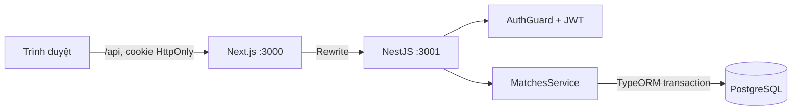
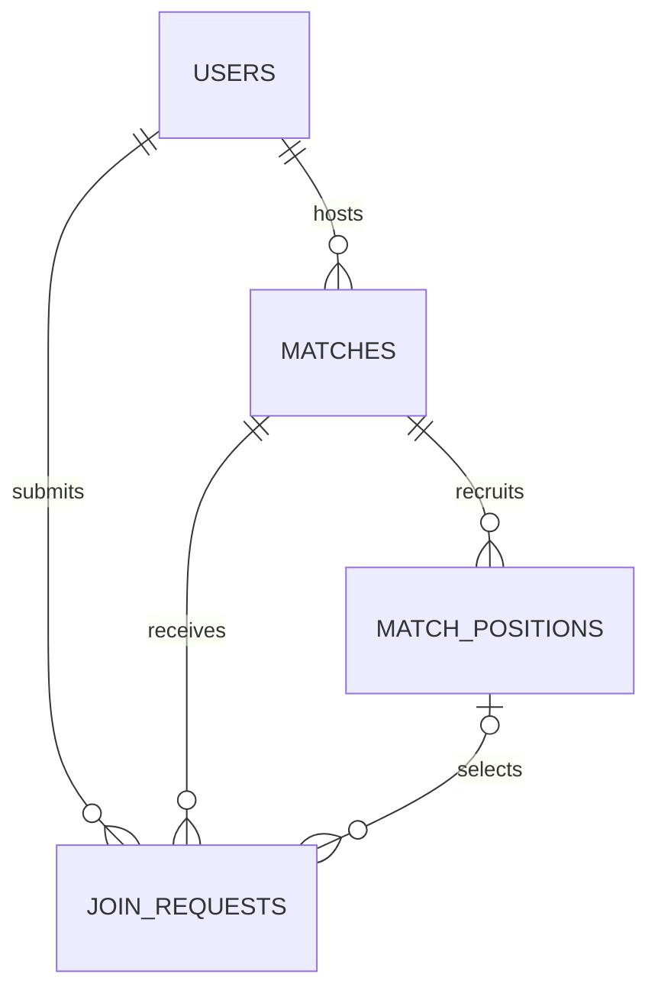

# Kiến trúc

Database Docker dùng cổng host 55432 để tránh PostgreSQL cài sẵn. Entity và migration là nguồn quản lý schema; `synchronize: false`.

Các gói lõi NestJS được ghim chung ở root để module DI của các workspace cùng dùng một bản. Override multer 2.5.0 và source-map-js 1.2.2 giữ các dependency phụ ở bản đã vá; cập nhật lockfile và kiểm tra audit khi nâng framework.

- `users`: email chuẩn hóa chữ thường/unique, scrypt hash + salt ngẫu nhiên, hồ sơ.
- `matches`: chủ kèo, môn, trình độ, địa điểm, thời gian timestamptz, phí, capacity, trạng thái.
- `match_positions`: vị trí và quota, gắn vào một trận.
- `join_requests`: unique trận/người, vị trí tùy chọn, lời nhắn, trạng thái, timestamps. Composite foreign key bảo đảm vị trí thuộc chính trận được xin.

Yêu cầu có vòng đời `pending → accepted | rejected | cancelled`; `accepted → cancelled` khi rời trận. Yêu cầu rejected/cancelled có thể trở lại pending trước giờ bắt đầu. Trận `open → cancelled | completed`; trận quá giờ tự ngừng tuyển dù chưa được đánh dấu completed.

Mọi thao tác ảnh hưởng đội hình dùng cùng khóa PostgreSQL `SELECT FOR UPDATE` trên trận trong transaction. Chỉ sau khi giữ khóa mới đọc số người accepted, kiểm quota và thay trạng thái. Hai lượt duyệt đồng thời cho một suất cuối được tuần tự hóa; lượt sau nhận 409. Không dựa vào số chỗ phía frontend.

Frontend chia `Dashboard` (khám phá/kèo của tôi/hồ sơ), `MatchCard`, `MatchDetail`, các form và `Modal` native dialog. Trình duyệt hiển thị giờ trận theo Asia/Ho_Chi_Minh, ngày lọc theo UTC+7; input tạo trận ghi rõ lấy giờ thiết bị và chuyển ISO UTC khi gửi.

Unit test dùng node:test; integration tạo database tạm riêng, chạy migration và HTTP server trên cổng tạm, kiểm thử transaction thật, rồi thu dọn. Không reset database phát triển.

Phạm vi hiện tại phù hợp cho phát triển nhóm và demo MVP. Các hạng mục trước khi mở công khai: xác minh email/khôi phục mật khẩu, thu hồi phiên, giám sát, backup, kiểm duyệt nội dung và rate limit phân tán; xem roadmap nghiên cứu.
